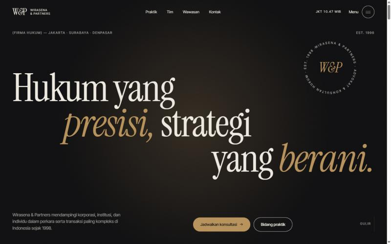
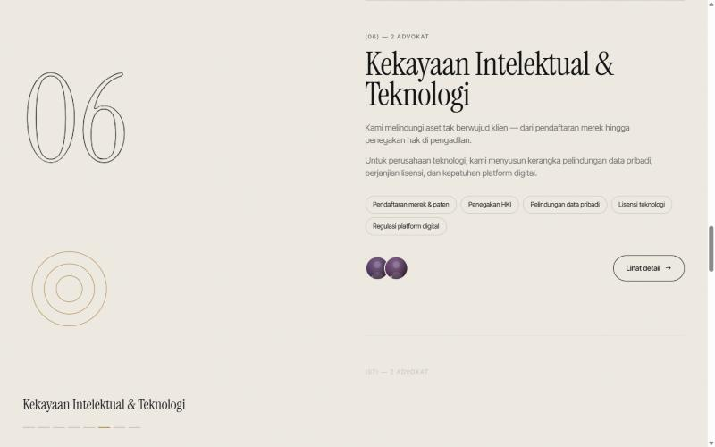
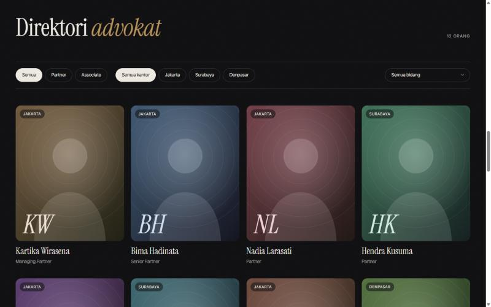
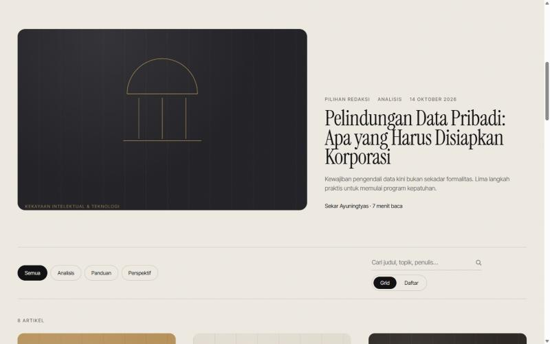
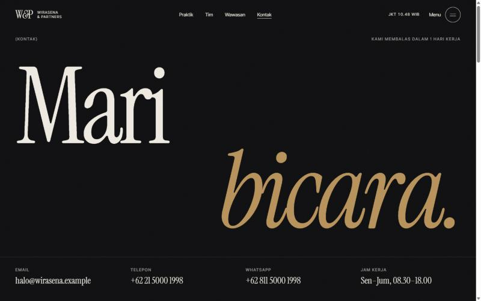

# Wirasena & Partners — Website Firma Hukum

Website firma hukum fiktif yang menonjolkan **layout kreatif dan animasi**. Dibangun dengan Astro, GSAP, dan Lenis.

> **Semua data di situs ini fiktif.** Nama firma, advokat, alamat, nomor telepon, artikel, dan statistik dibuat hanya untuk keperluan desain. Formulir di situs ini adalah demo dan tidak mengirim data ke mana pun.



| | |
| --- | --- |
|  |  |
|  |  |

Proses pembuatan dari awal sampai akhir didokumentasikan di **[docs/PROSES-PEMBUATAN.md](docs/PROSES-PEMBUATAN.md)**.

## Fitur

**Beranda (`/`)**
- Preloader hitungan 0–100% dengan tirai yang terbuka (sekali per sesi).
- Hero dengan judul yang hurufnya naik bertahap, segel teks melingkar yang berputar, dan cahaya yang mengikuti kursor. Hero tetap di tempat saat section berikutnya menutupinya.
- Dua pita marquee menyilang yang kecepatan, arah, dan kemiringannya mengikuti kecepatan scroll.
- Teks "Tentang kami" yang menyala kata demi kata, gambar garis gedung pengadilan yang tergambar sendiri, dan angka statistik yang menghitung naik.
- Bidang praktik yang bergeser horizontal saat scroll vertikal (section ter-pin).
- Kartu "Cara kami bekerja" yang bertumpuk; kartu lama mengecil dan meredup.
- Daftar tim dengan potret yang melayang mengikuti kursor.
- Grid artikel asimetris dengan parallax, dan section kontak dengan lingkaran yang membesar.

**Halaman indeks**
- `/praktik` — panel kiri menempel; angka dan judul berganti dengan efek gulungan (reel), glyph berganti, blok aktif menyala.
- `/tim` — kipas potret berlapis, kutipan pimpinan, direktori yang bisa difilter (jabatan, kantor, bidang) dengan animasi GSAP Flip, dan kartu yang miring 3D.
- `/wawasan` — artikel pilihan dengan parallax, filter kategori, pencarian langsung, dan tampilan grid/daftar yang bertransformasi dengan Flip.
- `/kontak` — huruf besar yang menyingkir dari kursor, tab kantor dengan jam lokal (WIB/WITA) dan status buka, penanda kantor di garis bujur Indonesia, formulir 3 langkah, dan FAQ.

**Halaman detail**
- `/layanan/[slug]` (8 bidang), `/tim/[slug]` (12 advokat), `/wawasan/[slug]` (9 artikel).

**Global**
- Smooth scroll (Lenis), kursor kustom dengan label, tombol magnetik, menu layar penuh, efek grain, dan transisi antar halaman (View Transitions API, khusus browser Chromium).
- Menghormati `prefers-reduced-motion`: animasi dimatikan, tetapi filter, tab, dan formulir tetap berfungsi.

## Teknologi

| Bagian | Pilihan |
| --- | --- |
| Framework | [Astro](https://astro.build) 7.4 (output statis) |
| Animasi | [GSAP](https://gsap.com) 3.15 — ScrollTrigger, SplitText, Flip |
| Smooth scroll | [Lenis](https://github.com/darkroomengineering/lenis) 1.3 |
| Font | Instrument Serif + Inter Tight (self-hosted via Fontsource) |
| Styling | CSS biasa dengan custom properties, tanpa framework CSS |

## Menjalankan

Butuh Node.js 22.23.4 atau lebih baru.

```bash
npm install
npm run dev      # server pengembangan di http://localhost:4321
npm run build    # build statis ke ./dist
npm run preview  # pratinjau hasil build
```

## Struktur folder

```text
src/
├── components/        Komponen bersama (Header, Footer, Portrait, Glyph, Cover, PageHero, …)
│   └── home/          Section beranda (Hero, Marquee, About, Practices, Approach, Team, Insights, Contact)
├── data/              Data palsu: firm.ts, practices.ts, lawyers.ts, insights.ts
├── layouts/Base.astro Kerangka HTML, font, CSS global, dan pemanggil script
├── lib/utils.ts       Helper kecil
├── pages/             Rute: beranda, halaman indeks, dan halaman detail [slug]
├── scripts/           Animasi & interaksi
│   ├── core.ts        Registrasi GSAP + Lenis, deteksi reduced motion & pointer
│   ├── main.ts        Urutan inisialisasi semua modul
│   ├── preloader.ts   Preloader beranda
│   ├── ui.ts          Kursor, tombol magnetik, header, menu, anchor, formulir sederhana
│   ├── reveals.ts     Animasi generik berbasis atribut data-*
│   ├── sections.ts    Animasi khusus section beranda
│   └── pages.ts       Interaksi halaman indeks (reel, Flip filter, tilt, repel, tab kantor, form bertahap)
└── styles/            global.css, home.css, pages.css, listing.css
```

## Animasi berbasis atribut

Animasi umum dipasang lewat atribut HTML, jadi halaman baru tidak perlu menulis JavaScript:

| Atribut | Efek |
| --- | --- |
| `data-split` | Judul muncul per baris dari balik mask saat masuk layar. `data-split="intro"` langsung main saat halaman dibuka. |
| `data-reveal` | Fade naik saat masuk layar (`"intro"` untuk saat halaman dibuka). |
| `data-stagger` | Anak-anak elemen muncul bergantian. |
| `data-words` | Kata demi kata menyala mengikuti scroll. |
| `data-parallax="0.15"` | Elemen bergeser lebih lambat/cepat dari scroll. |
| `data-counter="1400"` | Angka menghitung naik. |
| `data-draw` | Garis SVG (`pathLength="1"`) tergambar mengikuti scroll. |
| `data-clip` | Gambar terbuka dari bawah dengan zoom-out. |
| `data-magnetic` | Elemen tertarik ke arah kursor. |
| `data-cursor="Teks"` | Kursor membesar dan menampilkan label. |

## Mengganti data palsu

Semua konten ada di `src/data/`. Ubah atau ganti file-file itu dengan data asli, atau sambungkan ke CMS. Komponen hanya membaca dari sana. Potret advokat dan sampul artikel saat ini berupa ilustrasi SVG buatan (`Portrait.astro`, `Cover.astro`) sebagai pengganti foto.

## Catatan

- Formulir kontak dan newsletter belum terhubung ke backend.
- Situs ini memuat penafian umum: informasi bukan nasihat hukum, dan mengirim formulir tidak membentuk hubungan advokat–klien. Formulir meminta persetujuan pemrosesan data pribadi. Sesuaikan teks ini dengan kebijakan firma dan regulasi yang berlaku sebelum dipakai sungguhan.
