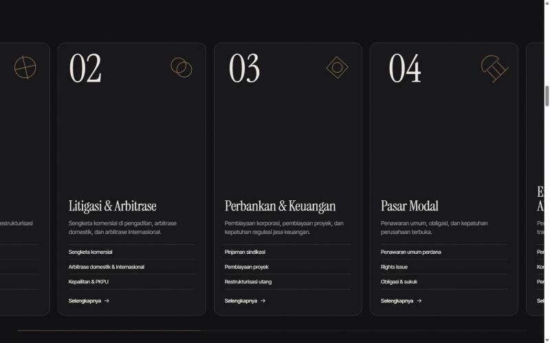
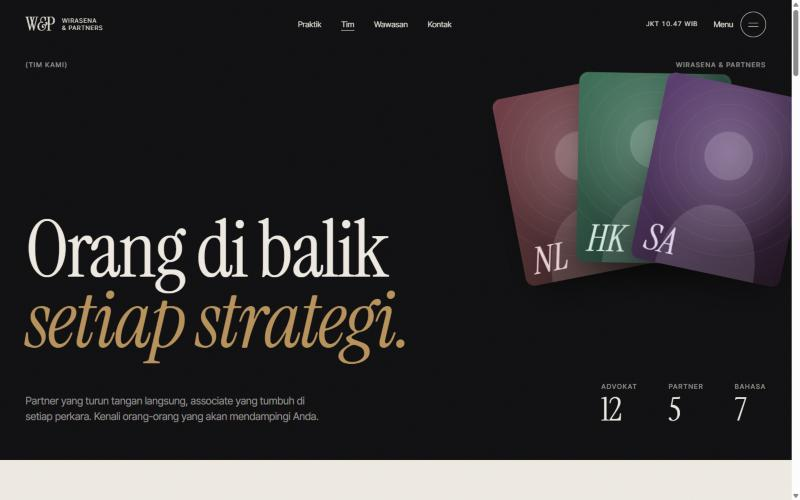
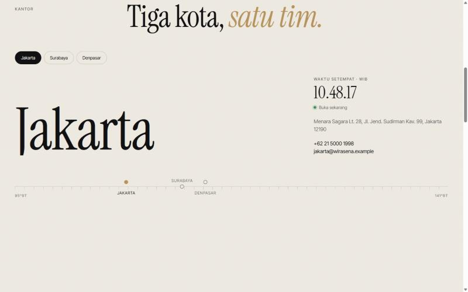

# Proses Pembuatan Website Wirasena & Partners

Dokumen ini mencatat proses pembuatan dari awal sampai akhir: permintaan awal, keputusan desain dan teknis, langkah pengerjaan, bug yang ditemukan saat pengujian beserta perbaikannya, dan hal-hal yang belum selesai.

Seluruh pekerjaan dilakukan dalam satu sesi pada 28 Oktober 2026 dengan **Claude Code** (di aplikasi desktop Claude), di Windows 11. Semua data di situs ini fiktif.

---

## Daftar isi

1. [Permintaan awal dan workflow](#1-permintaan-awal-dan-workflow)
2. [Klarifikasi kebutuhan dan pilihan stack](#2-klarifikasi-kebutuhan-dan-pilihan-stack)
3. [Menyiapkan lingkungan](#3-menyiapkan-lingkungan)
4. [Konsep desain](#4-konsep-desain)
5. [Data palsu](#5-data-palsu)
6. [Arsitektur animasi](#6-arsitektur-animasi)
7. [Iterasi 1: beranda dan halaman detail](#7-iterasi-1-beranda-dan-halaman-detail)
8. [Pengujian dan perbaikan iterasi 1](#8-pengujian-dan-perbaikan-iterasi-1)
9. [Iterasi 2: halaman terpisah untuk setiap menu](#9-iterasi-2-halaman-terpisah-untuk-setiap-menu)
10. [Pengujian dan perbaikan iterasi 2](#10-pengujian-dan-perbaikan-iterasi-2)
11. [Publikasi ke GitHub](#11-publikasi-ke-github)
12. [Batasan dan langkah berikutnya](#12-batasan-dan-langkah-berikutnya)
13. [Galeri screenshot](#13-galeri-screenshot)

---

## 1. Permintaan awal dan workflow

Permintaan pertama: *"saya ingin membuat dynamic website for lawfirm, bisakah kamu beri saya workflownya dulu?"*

Workflow yang diusulkan terdiri dari 10 fase:

1. **Discovery** — tujuan situs, target klien, daftar bidang praktik, bahasa, riset kompetitor, dan batasan Kode Etik Advokat Indonesia soal iklan (hindari klaim "terbaik" atau janji hasil perkara).
2. **Sitemap dan konten** — Beranda, Tentang, Bidang Praktik + detail, Tim + profil, Wawasan/Artikel, Karier, Kontak, Disclaimer, Kebijakan Privasi.
3. **Definisi "dinamis"** — saat itu diartikan sebagai konten yang dikelola lewat CMS.
4. **Pilihan stack** — rekomendasi Next.js + Payload CMS + PostgreSQL, dengan alternatif Laravel + Filament atau WordPress.
5. **Desain** — wireframe, brand, mockup, *trust signal*, aksesibilitas WCAG 2.1 AA.
6. **Data model** — Lawyer, PracticeArea, Article, Inquiry, Job, Office, User.
7. **Development** — urutan pengerjaan, form dengan validasi server dan CAPTCHA, i18n, SEO (sitemap, JSON-LD), analytics + cookie consent.
8. **Keamanan dan kepatuhan** — UU PDP (UU 27/2022): consent, kebijakan privasi, retensi data; disclaimer bahwa formulir tidak membentuk hubungan advokat–klien.
9. **Testing dan launch.**
10. **Maintenance.**

## 2. Klarifikasi kebutuhan dan pilihan stack

Permintaan berikutnya mengubah arah:

- *"pakai claude code dan coba kamu jalankan"* — langsung dibangun, bukan hanya direncanakan.
- *"dynamic disini artinya adanya kreatifitas pada layout dan animasi"* — fokus bergeser dari CMS ke **layout kreatif dan animasi**.
- *"gunakan data palsu dulu"* — semua konten fiktif.

**Pilihan stack.** Node.js dan Git belum terpasang di komputer. Dua opsi ditawarkan: HTML/CSS/JS murni tanpa instalasi, atau memasang Node.js untuk framework. Pilihan awal adalah **Next.js + GSAP + Lenis + Node.js**. Saat Node.js sedang dipasang, pilihan diganti menjadi **Astro**.

Astro cocok untuk kebutuhan ini karena:

- Output-nya HTML statis, jadi halaman cepat dimuat.
- JavaScript hanya dikirim untuk script yang memang dipakai; tidak ada runtime framework di browser.
- Halaman dinamis per slug (`[slug].astro` + `getStaticPaths`) mudah dibuat dari data.
- Data nanti bisa dipindah ke CMS tanpa mengubah komponen.

GSAP dipakai untuk semua animasi (ScrollTrigger, SplitText, Flip). Lenis dipakai untuk smooth scroll.

## 3. Menyiapkan lingkungan

| Langkah | Perintah / hasil |
| --- | --- |
| Pasang Node.js LTS | `winget install --id OpenJS.NodeJS.LTS -e` → Node v24.22.1, npm 11.19.1 |
| Buat project Astro | `npx --yes create-astro@latest lawfirm-site --template minimal --install --no-git --skip-houston --yes` → Astro 7.4.2 |
| Pasang library animasi | `npm install gsap lenis` → GSAP 3.15.0, Lenis 1.3.27 |
| Pasang font self-hosted | `npm install @fontsource/instrument-serif @fontsource-variable/inter-tight` |
| Konfigurasi Astro | Dev toolbar dimatikan (`devToolbar: { enabled: false }`) agar tidak mengganggu pratinjau. |

Font dipasang lewat Fontsource (bukan Google Fonts) supaya tidak ada permintaan ke server pihak ketiga. Ini juga lebih aman dari sisi privasi pengunjung.

Untuk pratinjau, dev server dijalankan dari panel browser bawaan aplikasi. Nama konfigurasi `astro-dev` ternyata sudah dipakai project lain di folder induk, sehingga server project lain yang terpanggil. Konfigurasi baru diberi nama `lawfirm-dev` dengan port 4330.

## 4. Konsep desain

**Arah visual:** editorial dan tenang seperti majalah hukum, dengan tipografi besar sebagai elemen utama, lalu diberi gerak yang berani.

**Palet** (CSS custom properties di `src/styles/global.css`):

| Token | Nilai | Peran |
| --- | --- | --- |
| `--ink` | `#0c0c0e` | Latar gelap utama |
| `--ink-2`, `--ink-3` | `#141417`, `#1f1f24` | Kartu dan variasi gelap |
| `--paper` | `#efebe3` | Latar terang, teks di atas gelap |
| `--paper-2` | `#e4ded2` | Variasi terang |
| `--brass` | `#b8925a` | Aksen: kata miring, garis progres, sorotan |

**Tipografi:** *Instrument Serif* (judul besar, miring untuk penekanan) dipasangkan dengan *Inter Tight* (teks dan label).

**Tema per section.** Section memakai kelas `.s-dark`, `.s-light`, atau `.s-brass`. Kelas ini mengisi variabel `--fg`, `--muted`, `--line`, dan `--inv`, sehingga komponen yang sama (tombol, chip, garis) otomatis menyesuaikan warnanya di latar mana pun.

**Detail global:**
- Efek grain film halus di seluruh halaman (SVG `feTurbulence`).
- Kursor kustom: titik cepat + cincin lambat dengan `mix-blend-mode: difference`, membesar dan menampilkan label pada elemen ber-`data-cursor`.
- Header dengan `mix-blend-mode: difference` agar tetap terbaca di latar gelap maupun terang. Header sembunyi saat scroll ke bawah dan muncul saat scroll ke atas. Header juga menampilkan jam Jakarta.
- Transisi antar halaman dengan cross-document View Transitions (CSS saja).

**Visual pengganti foto.** Agar tidak bergantung pada foto stok, semua gambar dibuat dari SVG generatif:
- `Portrait.astro` — potret ilustrasi per advokat (gradien sesuai `hue`, siluet, cincin, inisial).
- `Cover.astro` — sampul artikel dari palet dan glyph.
- `Glyph.astro` — 8 ikon geometris garis untuk bidang praktik.

## 5. Data palsu

Semua data berada di `src/data/` dan menjadi satu-satunya sumber konten:

| File | Isi |
| --- | --- |
| `firm.ts` | Nama firma, 3 kantor (Jakarta, Surabaya, Denpasar) beserta zona waktu dan bujur, statistik, 4 langkah "cara kerja", 12 industri, info karier, 5 FAQ |
| `practices.ts` | 8 bidang praktik: deskripsi dan daftar layanan |
| `lawyers.ts` | 12 advokat: jabatan, kantor, bidang, bio, pendidikan, izin, bahasa, kutipan (untuk pimpinan) |
| `insights.ts` | 9 artikel: kategori, penulis, tanggal, isi singkat |

Nama advokat, alamat, nomor telepon, dan email (`*.example`) semuanya fiktif.

## 6. Arsitektur animasi

**Pembagian file** (`src/scripts/`):

- `core.ts` — registrasi plugin GSAP, inisialisasi Lenis, deteksi reduced motion dan jenis pointer.
- `main.ts` — urutan inisialisasi semua modul.
- `reveals.ts` — animasi generik berbasis atribut (`data-split`, `data-reveal`, `data-words`, `data-parallax`, `data-counter`, `data-draw`, `data-clip`, `data-stagger`).
- `sections.ts` — animasi khusus section beranda.
- `pages.ts` — interaksi halaman indeks.
- `ui.ts` — kursor, tombol magnetik, header, menu, anchor, formulir.
- `preloader.ts` — preloader beranda.

**Integrasi Lenis + ScrollTrigger.** Lenis digerakkan oleh ticker GSAP, sehingga keduanya memakai satu loop animasi:

```ts
lenis = new Lenis({ lerp: 0.1 });
lenis.on('scroll', ScrollTrigger.update);
gsap.ticker.add((time) => lenis?.raf(time * 1000));
gsap.ticker.lagSmoothing(0);
```

**Mencegah kedipan konten.** Script kecil di `<head>` menambahkan kelas `motion` ke `<html>` sebelum halaman dirender, kecuali pengguna meminta reduced motion. CSS menyembunyikan elemen intro hanya bila kelas itu ada. Jika JavaScript gagal, animasi CSS *failsafe* menampilkan elemen itu setelah beberapa detik.

**Urutan ScrollTrigger.** Section bidang praktik di beranda di-*pin* (scroll horizontal). ScrollTrigger yang posisinya setelah pin harus dibuat setelah pin, agar jarak tambahan dari pin ikut dihitung. Karena itu `main.ts` memanggil modul sesuai urutan di halaman, lalu menjalankan `ScrollTrigger.sort()` dan `ScrollTrigger.refresh()`.

**SplitText.** Teks dipecah setelah `document.fonts.ready`, supaya pemecahan baris memakai font yang benar. Setelah animasi muncul selesai, hasil pecahan di-*revert*, sehingga teks kembali normal dan tetap rapi saat jendela diubah ukurannya.

**Aksesibilitas.**
- Saat reduced motion aktif, Lenis dan semua animasi dimatikan. Filter, tab kantor, formulir bertahap, dan FAQ tetap berfungsi.
- Kursor kustom hanya aktif di perangkat dengan pointer presisi.
- Menu memakai `inert` saat tertutup dan bisa ditutup dengan tombol Esc. Tab kantor bisa dipindah dengan tombol panah.
- FAQ memakai elemen `<details>` bawaan, sehingga tetap jalan tanpa JavaScript.

## 7. Iterasi 1: beranda dan halaman detail

Section beranda dan teknik yang dipakai:

| Section | Efek | Teknik |
| --- | --- | --- |
| Preloader | Hitungan 0–100%, nama firma naik per huruf, tirai terbuka ke atas | Timeline GSAP, `clip-path`, `sessionStorage` agar hanya sekali per sesi |
| Hero | Huruf judul naik bertahap; baris judul bergeser saat scroll; segel teks melingkar berputar; cahaya mengikuti kursor | SplitText (`chars` + mask baris), `position: sticky`, `quickTo` |
| Marquee | Dua pita menyilang; kecepatan, arah, dan kemiringan mengikuti scroll | `gsap.ticker` + `lenis.velocity`, `quickSetter` |
| Tentang | Kata menyala satu per satu; gambar garis gedung pengadilan tergambar; angka menghitung | SplitText `words` + scrub, SVG `pathLength="1"` + `stroke-dashoffset` |
| Bidang praktik | Scroll vertikal menjadi geser horizontal; angka dan glyph kartu ikut bergerak | ScrollTrigger `pin` + `containerAnimation`; di mobile jadi daftar biasa (`gsap.matchMedia`) |
| Cara kerja | Kartu menumpuk; kartu lama mengecil dan meredup | `position: sticky` + scrub `scale` dan variabel CSS `--dim` |
| Tim | Baris terisi warna saat hover; potret melayang mengikuti kursor dan miring sesuai arah gerak | `quickTo` x/y/rotation, `clip-path` reveal |
| Wawasan | Grid asimetris dengan kecepatan parallax berbeda | `data-parallax` |
| Kontak | Lingkaran brass membesar menutup section; judul membesar | Scrub `clip-path: circle()` |
| Footer | Nama firma raksasa yang hurufnya naik | Scrub stagger |

Halaman detail yang dibuat dari data:

- `/layanan/[slug]` — angka outline raksasa dengan parallax, daftar layanan, advokat terkait, artikel terkait, dan tautan ke bidang berikutnya.
- `/tim/[slug]` — potret yang terbuka dengan clip reveal, nama besar, fakta singkat, bio yang menyala per kata, dan pendidikan serta izin praktik.
- `/wawasan/[slug]` — bilah progres baca, sampul dengan parallax, huruf awal besar (*drop cap*), dan catatan bahwa artikel fiktif dan bukan nasihat hukum.

## 8. Pengujian dan perbaikan iterasi 1

Setiap perubahan diperiksa dengan `npm run build`, lalu dibuka di browser pada ukuran desktop (1440×900) dan mobile (375×812). Console browser juga diperiksa untuk error.

| Masalah yang ditemukan | Penyebab | Perbaikan |
| --- | --- | --- |
| Teks "Tentang kami" hanya selebar satu kolom | Aturan grid hanya menyasar `h2`, sedangkan teksnya `<p>` | `.head-grid > :not(.label)` |
| Kata "bicara." di section kontak tidak terlihat | Teks miring berwarna brass di atas latar brass | Warna kata itu diganti ke `--paper` |
| Item menu tidak bergeser saat hover | GSAP menulis `transform` inline yang menimpa `transform` dari CSS | Efek hover memakai `padding-left` |
| Angka outline di hero halaman layanan hampir tak terlihat | Garis 1px dengan opasitas 0,18 | Dipertebal menjadi 1,5px dengan opasitas 0,3 |
| Nama firma di preloader terpotong di mobile | Baris tidak boleh membungkus | Di layar < 600px, susunan menjadi kolom dan teks boleh membungkus |
| Segel melingkar menutupi judul hero di mobile | Posisi segel tumpang tindih dengan judul | Dipindah ke celah di atas judul |
| Ada jeda kosong antara preloader dan hero | Intro hero baru mulai setelah tirai hampir selesai | Intro dimulai 1 detik sebelum tirai selesai |

## 9. Iterasi 2: halaman terpisah untuk setiap menu

Permintaan: *"kembangkan lebih jauh untuk setiap halaman (halaman terpisah) pada menu"* — untuk menu Praktik, Tim, Wawasan, dan Kontak.

Setiap halaman diberi konsep layout dan animasi yang berbeda:

**`/praktik` — indeks dengan panel menempel**
- Hero berisi grid 8 glyph yang muncul berputar, berputar terus pelan, dan bergeser saat scroll.
- Panel kiri menempel. Angka dan judul berganti dengan efek gulungan (*reel*): satu kolom berisi semua item digeser dengan `yPercent`. Glyph berganti dengan rotasi.
- Blok yang sedang dibaca menyala, sisanya meredup. Titik navigasi bisa diklik untuk loncat ke bidang tertentu.
- Section industri berupa daftar kata besar.

**`/tim` — direktori interaktif**
- Hero berupa kipas 3 potret yang masuk bertahap lalu bergerak berlapis (efek kedalaman) mengikuti kursor dan scroll.
- Section pimpinan dengan kutipan yang menyala kata demi kata.
- Direktori 12 advokat dengan filter jabatan, kantor, dan bidang. Perpindahan kartu dianimasikan dengan **GSAP Flip**.
- Kartu miring 3D dan memantulkan kilau mengikuti posisi kursor.
- Section karier.

**`/wawasan` — arsip artikel**
- Artikel pilihan tampil besar dengan sampul yang terbuka (clip reveal) dan parallax.
- Filter kategori dan pencarian langsung (judul, ringkasan, penulis).
- Tampilan bisa ditukar antara **grid dan daftar**; kartu dan sampulnya berubah bentuk dengan Flip.
- Formulir newsletter (demo).

**`/kontak` — halaman interaktif**
- Huruf besar "Mari bicara." yang **menyingkir dari kursor**. Jarak tiap huruf ke kursor dihitung dari posisi asalnya, supaya huruf tidak bergetar.
- Tab kantor dengan nama kota yang muncul per huruf, **jam lokal yang berdetak** (WIB/WITA via `Intl.DateTimeFormat`), dan status "Buka sekarang"/"Sedang tutup" berdasarkan jam kerja setempat.
- Penanda kantor di **garis bujur Indonesia** (95°–141° BT); penanda bisa diklik.
- **Formulir 3 langkah** (kebutuhan → detail → kontak) dengan validasi per langkah, bilah progres, animasi geser antar langkah, dan layar terima kasih dengan centang yang tergambar.
- FAQ dengan animasi buka-tutup di atas `<details>`.

**Perubahan pendukung:**
- Komponen `PageHero.astro` untuk hero halaman indeks.
- Data tambahan: 4 advokat, 3 artikel, kota kantor per advokat, industri, karier, FAQ, zona waktu dan bujur kantor.
- Menu header dan menu layar penuh menautkan ke halaman baru dan menandai halaman aktif (`aria-current="page"`).
- Tautan "kembali" di halaman detail diarahkan ke halaman indeks baru.
- Beranda mendapat tautan "Semua …" ke tiap halaman; daftar tim di beranda dibatasi 8 orang.

## 10. Pengujian dan perbaikan iterasi 2

| Masalah yang ditemukan | Penyebab | Perbaikan |
| --- | --- | --- |
| Saat filter dijalankan, section di bawah direktori meloncat naik | Flip dengan `absolute: true` membuat kartu keluar dari alur, sehingga tinggi grid kolaps selama animasi | Tinggi grid ikut dianimasikan dari tinggi lama ke tinggi baru |
| Huruf di `/kontak` dan potret melayang di beranda tidak berotasi | `gsap.quickTo()` tidak menerima alias `rotate` | Diganti nama properti asli: `rotation` |
| Teks segel melingkar di hero menumpuk di ujung ("EST. 1WIRASENA") | Panjang teks melebihi keliling lingkaran | `textLength` pada `<textPath>` dikunci ke keliling (2π × 82 ≈ 514) dan ukuran font dikecilkan |

Bug terakhir ditemukan saat mengambil screenshot untuk dokumentasi ini.

Console browser sesekali mencatat `AbortError: Transition was skipped`. Pesan ini berasal dari View Transitions saat navigasi otomatis yang beruntun selama pengujian. Pesan ini bukan error kode situs.

## 11. Publikasi ke GitHub

| Langkah | Keterangan |
| --- | --- |
| Pasang Git | `winget install --id Git.Git -e` → Git 2.56.0 |
| Cek repository tujuan | `git ls-remote` → repository masih kosong |
| Abaikan file lokal | `.claude/` (konfigurasi pratinjau dengan path lokal) ditambahkan ke `.gitignore`, di samping `node_modules/`, `dist/`, dan `.astro/` |
| Commit | Email commit memakai alamat *noreply* GitHub agar email pribadi tidak tampil di riwayat publik |
| Push | Ke cabang `main` di `github.com/magiapixx/01lawfirm-wirasena-partners` |

## 12. Batasan dan langkah berikutnya

**Belum diuji / belum selesai**
- Mode reduced motion belum diuji secara visual untuk semua halaman.
- Hero `/wawasan` belum punya elemen dekoratif di sisi kanan.
- Formulir (kontak, konsultasi 3 langkah, newsletter) masih demo dan belum terhubung ke backend.
- Halaman **Kebijakan Privasi** dan **Disclaimer** disebut di formulir dan footer, tetapi halamannya belum dibuat.
- Transisi antar halaman hanya berjalan di browser berbasis Chromium.

**Langkah berikutnya yang disarankan**
1. Ganti data palsu dengan data asli, atau sambungkan `src/data/` ke CMS (misalnya headless CMS dengan koleksi Lawyer, PracticeArea, Article).
2. Ganti potret ilustrasi dengan foto asli.
3. Sambungkan formulir ke backend dengan validasi server, perlindungan spam (misalnya Cloudflare Turnstile), dan notifikasi email.
4. Buat halaman Kebijakan Privasi dan Disclaimer, lalu minta partner meninjau semua teks agar sesuai Kode Etik Advokat dan UU PDP.
5. Lengkapi SEO: `sitemap.xml`, gambar Open Graph, dan JSON-LD per halaman (`Person` untuk advokat, `Article` untuk artikel).
6. Deploy (misalnya ke hosting statis) dan daftarkan ke Google Search Console.

## 13. Galeri screenshot

Diambil pada viewport 1440×900.

**Beranda — hero**


**Beranda — bidang praktik bergeser horizontal**


**/praktik — panel menempel dengan reel angka**


**/tim — kipas potret**


**/tim — direktori dengan filter**


**/wawasan — artikel pilihan, filter, dan pencarian**


**/kontak — huruf yang menyingkir dari kursor**


**/kontak — tab kantor, jam lokal, dan garis bujur**

